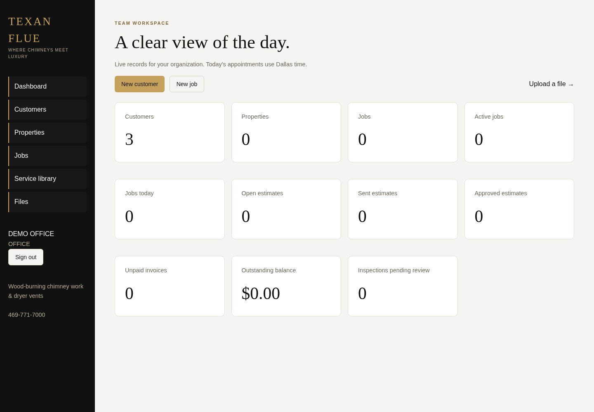
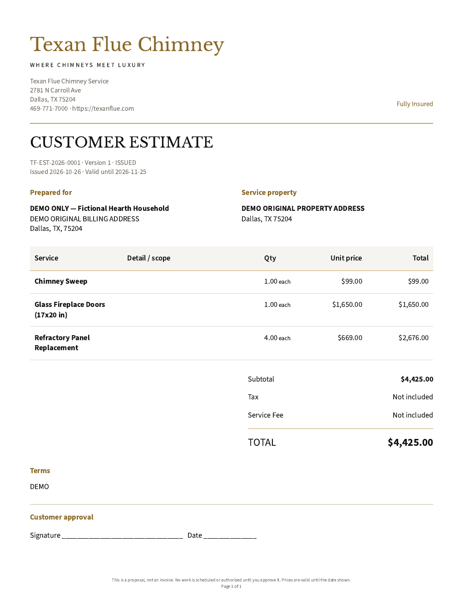

# Texan Flue Management System

Phases A–B: team login, customers and properties, jobs, appointments, technician assignments, service catalog, private files, estimate builder, immutable document snapshots and branded PDFs. Next.js App Router, TypeScript, Tailwind/shadcn UI, Auth.js, Prisma and PostgreSQL.

## Run locally

Requires Node.js 22.12+ (tested with Node 24), npm and Docker Compose v2. From the repository root:

```sh
npm ci
npm run setup:env
docker compose up -d --wait
npm run db:generate
npm run db:migrate
npm run db:seed
npx playwright install chromium
npm run dev
```

Open the app on port 3000 on your development machine. `setup:env` creates an ignored, mode-0600 `.env` from `.env.example`, generates local-only authentication and demo-password secrets, and preserves an existing `.env`. If your npm cache is not writable, append `--cache /tmp/texan-npm-cache` to `npm ci`.

Demo accounts:

| Email                        | Role       |
| ---------------------------- | ---------- |
| demo.admin@example.test      | ADMIN      |
| demo.office@example.test     | OFFICE     |
| demo.technician@example.test | TECHNICIAN |

Their initial password is the `SEED_DEMO_PASSWORD` value in your local `.env`. No universal password is committed. Seed reruns preserve existing users, passwords, settings and catalog edits. To change a user's password after seeding, use password reset rather than changing the seed variable.

The seed creates the real organization address and phone, DEMO settings, three DEMO users and nineteen catalog entries explicitly marked DEMO. It fabricates no catalog prices or customer jobs. Organization email is blank because no verified email was supplied. Tax, fees and AI are disabled. Review starter descriptions and enter real prices as ADMIN before use.

PDF rendering requires Chromium: install the bundled browser as above, or set `PLAYWRIGHT_CHROMIUM_EXECUTABLE_PATH` in `.env` to your installed Chromium (this environment uses `/usr/bin/chromium`). PDF acceptance tests additionally require Poppler (`brew install poppler` on macOS; `poppler-utils` on Linux).

Estimates are at `/estimates`; ADMIN template editing is at `/settings/templates`. Save a draft before previewing or issuing. Issue freezes the PDF/snapshot; edits thereafter require a new numbered revision. Tax and fees remain settings-gated; removal requires confirmation. Status updates are manual records, with no delivery/signature integration implied. See [Phase B evidence and limitations](docs/PHASE-B-REPORT.md).

## Screenshots

Desktop dashboard using real DEMO database counts:



[Mobile jobs screen](docs/screenshots/jobs-mobile.png).

Actual issued acceptance PDF, $4,425.00:



[Pagination page two](docs/screenshots/phase-b-pagination-page-two.png).

## Checks

```sh
npm run lint
npm run typecheck
npm test
npx playwright install chromium
npm run test:e2e
npm run build
```

For a machine with a preinstalled Chromium, replace the browser-install step with:

```sh
PLAYWRIGHT_CHROMIUM_EXECUTABLE_PATH=/usr/bin/chromium npm run test:e2e
```

Playwright starts its own development server unless one is already running. Run against the local DEMO database only: the suite creates DEMO records, updates catalog prices on its own DEMO entries and archives its own customer. It does not erase existing data. E2E checks include real browser forms and direct authenticated HTTP requests against PostgreSQL, not mocked authorization. Unit tests run without a database.

With the app running, `npm run smoke` verifies demo login, a live authenticated dashboard request and logout without printing credentials.

For an optimized server:

```sh
npm run build
npm start
```

## Password reset and private files

Use **Forgot password?** on the login screen. In local development, reset emails are captured as private JSON files in `private/mail/`; read the link there and open it in the browser. These files contain sensitive single-use links and must not be published. Reset links expire after 30 minutes and are stored as hashes in PostgreSQL. Resetting revokes all active sessions. Sign-out revokes the matching server-side session. Auth.js uses encrypted JWT cookies plus a checked, hashed server-side session handle; sessions expire after eight hours. HTTPS enables secure cookies.

Production reset delivery requires `MAIL_MODE=smtp`, `SMTP_URL` and `MAIL_FROM`. Capture delivery is deliberately disabled under `NODE_ENV=production`. SMTP transport is implemented but outbound delivery was not tested with a real provider. The reset request returns the same response for unknown accounts; failed delivery is logged without exposing the account or token.

Uploads live outside `public/`, default `private/uploads/`, with randomized storage keys. Allowed formats: PDF, PNG, JPEG and WebP; maximum 10 MiB. The server bounds streamed bodies and checks extension, MIME and content signature. Downloads are attachments, require an authorized session, and use a five-minute HMAC link bound to the user. A public or expired URL cannot fetch a file. Local storage is implemented; S3 and malware scanning are not.

## Authorization and data

Every application API resolves the current session and current user from PostgreSQL. Role/organization/assignment filters are shared with server-rendered pages. Technicians get 404 for unassigned jobs and can only read customers/properties connected to assigned active jobs. Admin routes are denied on the server. ADMIN and OFFICE can maintain customers/properties/jobs and assign technicians; only ADMIN can archive records or edit catalog wording/prices. Archived customers/properties also hide dependent jobs from all reads. Prices are versioned within a locked transaction; amounts are integer cents.

Files are scoped through their uploader's organization. Technicians can access their own files and files linked to their assigned active jobs. Standalone uploads are not exposed across organizations. Customer/property/job queries return at most 200 matching records; narrow the search for larger datasets. Search supports customer name, phone, email and property address. The company settings page is ADMIN-only and read-only in Phase A.

## Migrations and backups

Use `npm run db:migrate` for checked-in migrations, never `db push`. For intentional future schema changes:

```sh
npx prisma migrate dev --name describe_change
npm run db:generate
```

The initial migrations create the complete supplied domain model and a separate PostgreSQL sequence for collision-safe job numbers. Phase B adds database immutability guards for issued document versions and PDF assets, with no Prisma schema changes. The only semantic Prisma schema addition is the missing inverse field `ServiceCatalogItem.estimateLineItems`; no column, foreign key or existing relation was restructured. Corrupted schema comment text was replaced with ASCII.

Local backup and a non-destructive restore into a separate database:

```sh
docker compose exec -T db pg_dump -U texan -d texan_flue -Fc > texan-flue.backup
docker compose exec -T db createdb -U texan texan_flue_restore
docker compose exec -T db pg_restore -U texan -d texan_flue_restore < texan-flue.backup
```

Back up private file storage separately along with the database. Backup/restore commands are documentation only until explicitly exercised; they are not a disaster-recovery guarantee. `docker compose down` preserves the database volume; `docker compose down -v` deletes it. Docker volumes need a separate backup and are not assumed to survive a cloud snapshot.

## Deployment boundaries

Use a persistent PostgreSQL service, persistent private upload volume, trusted HTTPS reverse proxy, real SMTP credentials and strong `AUTH_SECRET`. Set `AUTH_URL` to the exact HTTPS origin; never reuse local demo credentials. `AUTH_TRUST_HOST=true` assumes the reverse proxy sanitizes forwarded host headers. Configure an upstream request-size limit and rate limiter before public exposure. The application limiter is in-process; multiple replicas require shared rate limiting. Do not seed demo accounts into a live customer database. Configure retention/monitoring, review access rules, and test backups before production use.

Phase B estimates, snapshots and PDF generation are implemented. Invoices, inspections, signatures, AI, manual payments and receipts are not implemented. See [the Phase A report](docs/PHASE-A-REPORT.md) for validation evidence and explicit remaining work. Company claims are limited to **Fully Insured**; services focus on wood-burning chimney work and dryer vents.

Design references: [brief](docs/CODEX-BRIEF.md), [decisions](docs/DECISIONS.md), [domain model](prisma/schema.prisma), [master spec](TEXAN_FLUE_CODEX_MASTER_SPEC.md), [PDF contract](docs/PDF-TEMPLATES.md), and [current scope](PHASE-A-PROMPT.txt).
